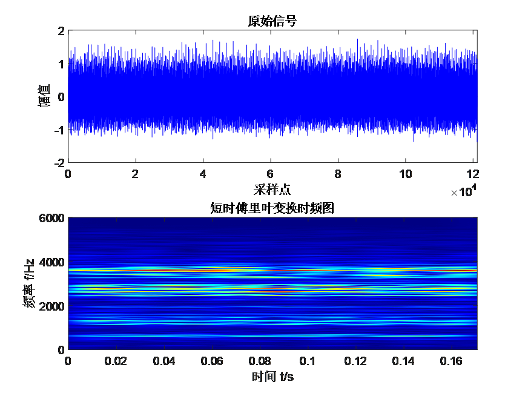
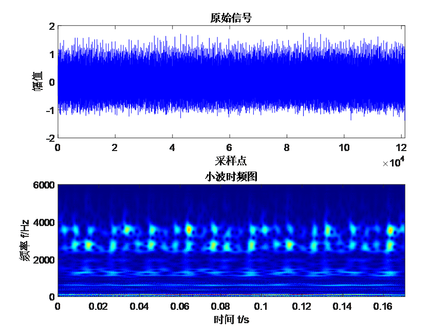
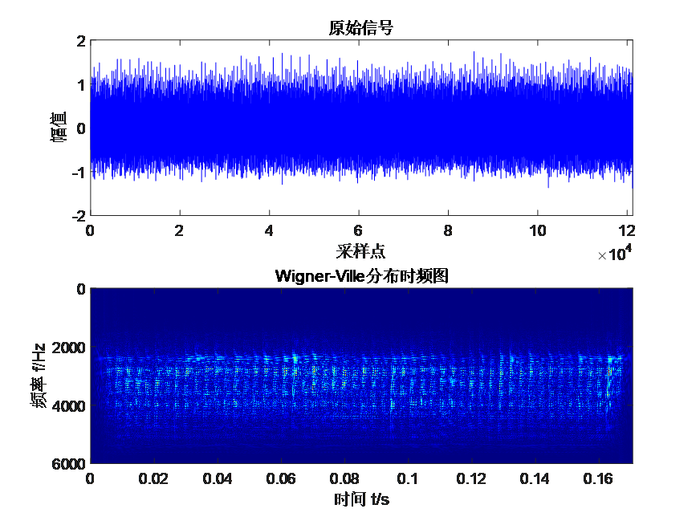
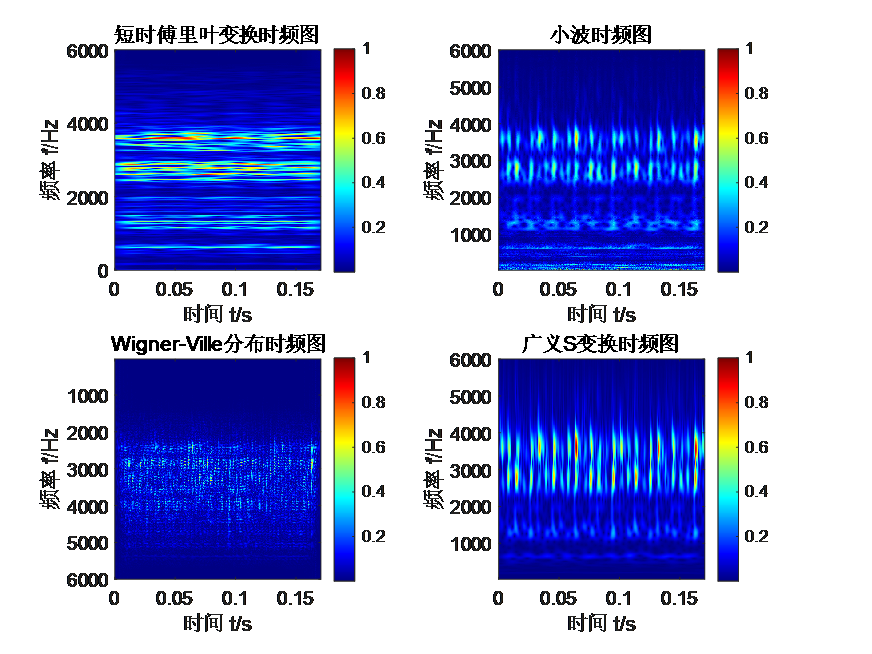

# Four types of time-frequency diagrams! Generalized S transform, wavelet transform, Short Time Fourier Transform (STFT), Wigner-Ville distribution. Run directly!

Applicable Platform: MATLAB 2020 version and above
In practical applications, time-frequency analysis is often combined with machine learning/deep learning techniques to enhance the performance of fault identification. Time-frequency analysis can capture the instantaneous changes in both time and frequency, which are beneficial for detecting transient features related to faults such as pulses, vibrations, or other sudden changes. This is crucial for processing non-stationary signals and rapidly changing faults. Below, we introduce four methods of time-frequency analysis:
Short-time Fourier Transform (STFT): STFT is based on the Fourier transform, segmenting the signal into multiple short-time windows, and then performing a Fourier transform on the signal within each window. By applying the Fourier transform at different temporal locations, local characteristics of the signal in time and frequency can be obtained. Its spectral representation is calculated by sliding a time window, hence the time-frequency resolution is limited by the Heisenberg Uncertainty Principle, meaning that using short windows has high time resolution but low frequency resolution; conversely, using long windows has low time resolution but high frequency resolution. Once the window function for STFT is determined, the corresponding time-frequency resolution is also established. It is evident that STFT is a single-resolution analysis method.
Characteristics:
Provides local information about the signal in time and frequency.
A compromise exists between time-domain and frequency-domain resolution.
Depends on the choice of window functions, different windows may be suitable for different types of signals.
Wavelet Transform: Wavelet transform decomposes the signal using wavelet base functions, obtaining components at different scales and frequencies. By adjusting the scale and translation parameters of the wavelet base functions, multi-scale analysis of the signal can be achieved. One advantage of wavelet transform over Fourier transform is its ability to display localized features of the signal, while Fourier transform focuses on the overall characteristics of the signal.
Characteristics:
Has good localization properties, achieving good resolution in both time and frequency domains.
Adapts to localized changes in the signal.
The choice of wavelet basis functions affects the analysis results.
1. Generalized S transform: The generalized S transform is a time-frequency analysis method aimed at addressing the limitations of traditional Fourier transforms and short-time Fourier transforms for analyzing non-stationary signals. By selecting appropriate kernel functions and adjusting parameters, it achieves resolution at different times and frequencies. It can capture the local instantaneous frequency at different points in time, suitable for signals with significant instantaneous frequency changes, providing more detailed time-frequency analysis results. Its core idea is to perform localized processing using an adjustable kernel function.
Characteristics:
It can handle non-stationary signals and is suitable for signals with instantaneous frequency changes.
Different parameter selections affect the analysis results, requiring adjustment based on the characteristics of the signal.
Wigner-Ville distribution: The Wigner-Ville distribution is a joint time-frequency analysis method that calculates the instantaneous autocorrelation function of the signal to obtain information about the signal in both the time-frequency domain. Since the Wigner-Ville distribution does not contain any window functions, it avoids the contradiction between the time resolution and frequency resolution in linear time-frequency analysis methods. The Wigner-Ville distribution has high time-frequency resolution and good time-frequency clustering, making it suitable for analyzing non-stationary signals. However, its disadvantage is that there are severe cross terms in the time-frequency plane, which can affect the results of time-frequency analysis.
Characteristics:
Provides precise time-frequency information, avoiding ambiguity.
Suitable for non-stationary signals.
Exists cross terms, which may cause interference and ambiguity.
Result analysis:
Taking the above raw signal as an example, comparing four time-frequency plots shows:
Short-time Fourier transform: Due to the use of a fixed window function, its time-frequency resolution remains constant, although it can provide the joint time-frequency characteristics of the signal, but overall it presents a low resolution situation;
Wavelet Transform: It has high frequency domain resolution at the low end but poor time resolution, while it has better time resolution at the high end and relatively reduced frequency resolution.
Wigner-Ville Distribution: As a bilinear time-frequency analysis method, it inevitably involves cross terms and has weaker energy compared to other time-frequency analysis methods.
Generalized S Transform: In the time-frequency spectrum, the Gaussian window function used by the generalized S transform adjusts its size according to the signal's frequency, thereby correcting the phase issues of wavelet transformation. Therefore, in comparison to wavelet transformation, it significantly improves both time and frequency resolutions on the time-frequency spectrum.
In summary, different time-frequency analysis methods differ in their principles and characteristics. The choice of method usually depends on the specific signal to be analyzed, such as the need for time or frequency domain resolution, the ability to handle non-stationarity, and the tolerance for computational complexity, requiring a comprehensive consideration for selection.

## Images

<!-- PAYMENT_BLOCK -->

## Get this dataset

- Payment link (Stripe): [Buy now](https://buy.stripe.com/3cs8yP7sY87d0vu9AB)
- Payment QR code: 

<!-- /PAYMENT_BLOCK -->
